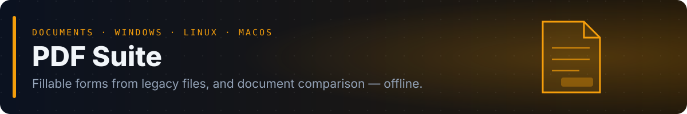

<!--
  PDF Suite — README
  Created by Redfox using Claude
-->

<div align="center">



<br />

[](https://github.com/RafaDevpt/pdf-suite/actions/workflows/ci.yml)
[](https://github.com/RafaDevpt/pdf-suite/releases/latest)


<br /><br />

<a href="https://github.com/RafaDevpt/Personal-AI-Projects"></a>
<a href="https://github.com/RafaDevpt/pdf-suite/releases/latest"></a>

<sub>Part of <a href="https://github.com/RafaDevpt/Personal-AI-Projects"><b>Personal AI Projects</b></a> by Redfox</sub>

</div>

# 📚 PDF Suite

> **Modernise legacy forms · Make PDFs fillable · Compare and summarise documents**

> ⚠️ **Work in progress.** The conversion and comparison engines are in place; the interface, reporting and packaging are not finished. Expect breaking changes.

---

## Why it exists

Two problems, one document pipeline.

The first is **legacy forms**: Excel files built a decade ago, held together by VBA macros nobody wants to touch. They break on new Office versions, trigger macro security warnings, can't be filled on a phone, and the person who wrote the code left years ago.

The second is **document comparison**: six supplier proposals land in the inbox and someone needs an answer by Friday. Opening them side by side and building a table in Excel is mechanical work — the decision is not. This automates the first part and leaves the second where it belongs.

Both are the same underlying job: read documents, understand their structure, produce something useful. So they share one tool.

---

## Modules

### 🔄 Form Modernizer

Converts legacy Excel forms with VBA macros into modern fillable documents, carrying the original automations across or improving on them.

```
┌─────────────┐   ┌─────────────┐   ┌─────────────┐   ┌─────────────┐
│  Analyse    │──►│  Parse VBA  │──►│    Map      │──►│  Generate   │
│  workbook   │   │  rule-based │   │  to fields  │   │  PDF / DOCX │
└─────────────┘   └─────────────┘   └─────────────┘   └─────────────┘
```

| Stage | What happens |
| :--- | :--- |
| **Analyse** | Reads workbook structure — cells, labels, merged ranges, data validation, protected areas — and infers where the fields are |
| **Parse VBA** | Extracts macro code and translates its intent (validation, calculation, conditional visibility) with a deterministic rule engine |
| **Map** | Turns each detected input into a typed form field: text, number, date, dropdown, checkbox |
| **Generate** | Produces a fillable PDF or Word document with the automations reimplemented natively |

The output format is chosen **per conversion**, not fixed at install time.

---

### 📝 Fillable Forms

Takes any flat PDF — a scan, an export, something a supplier sent — and rebuilds it with proper typed form fields. No Excel source required.

---

### ⚖️ Document Comparison

Point it at a set of documents and get back a structured verdict.

- Compares **multiple documents at once**
- Accepts **PDF, Word and other text formats**
- Extracts and aligns the comparable points — pricing, scope, terms, timelines
- Produces a **detailed report identifying the strongest offer and why**
- Also works as a plain summariser for long reports

---

## Fully offline

VBA is interpreted **locally, by rules — no AI API call, no upload, nothing leaves the machine.**

This was a hard requirement, not a preference. Corporate forms and supplier proposals carry commercial terms, internal procedures and personal data; sending them to a third-party service to be processed is not an option in a compliance-bound environment.

---

## Current state

| Component | Status |
| :--- | :---: |
| Excel/VBA analysis and rule engine | ✅ |
| PDF field detection and generation | ✅ |
| Document text extraction (PDF / DOCX / TXT) | ✅ |
| Comparison engine | ✅ |
| Graphical interface | 🚧 |
| Report generation | 🚧 |
| Test coverage | ⬜ |
| Packaging and launcher | ⬜ |

---

## Installation

```bash
git clone --branch pdf-suite --single-branch https://github.com/RafaDevpt/Personal-AI-Projects.git
cd Personal-AI-Projects
python -m venv .venv
.venv\Scripts\activate
pip install -r requirements.txt
```

---

## Usage

```bash
python main.py
```

Source files are never modified — output is always written alongside them as new documents.

---

## Known limits

<details>
<summary><b>What the VBA rule engine handles, and what it doesn't</b></summary>

<br />

**Handled well**
- Field detection from labels and adjacent cells
- Data validation lists → dropdowns
- Simple arithmetic and totals
- Required-field and format validation
- Conditional show/hide driven by a single control

**Needs manual review**
- Macros calling external files, databases or COM objects
- Multi-sheet logic with cross-references
- Custom UserForms
- Anything driven by `Application.Run` or dynamic evaluation

The tool flags what it could not translate rather than silently dropping it.

</details>

---

## Roadmap

- [ ] Complete the graphical interface
- [ ] Report generation with export to PDF
- [ ] Batch conversion of a whole folder
- [ ] Field mapping override before generation
- [ ] Digital signature fields in PDF output
- [ ] Test suite and packaging with `.bat` launcher

---

## Licence

GPL-3.0 — see [`LICENSE`](LICENSE) in the repository root.

<div align="center">
<sub>Created by Redfox using Claude</sub>
</div>


## 🐳 Docker & Terraform

The graphical interface stays a desktop app: a container has no screen. Docker runs the command line, which is the part worth automating.

Files: [`PDF-Suite/Linux/Dockerfile`](PDF-Suite/Linux/Dockerfile) · [`PDF-Suite/Linux/terraform/`](PDF-Suite/Linux/terraform/)

### Docker

```bash
cd PDF-Suite/Linux
docker build -t local/pdf-suite .
docker run --rm local/pdf-suite --help
```

Everything the app reads or writes lives in `/dados`; a host folder is mounted there and the container runs as the invoking user (`--user`), so the files it writes belong to that user.

Compare two quotes and export to Excel:

```bash
docker run --rm --user "$(id -u):$(id -g)" -v "$PWD:/dados" local/pdf-suite comparar proposta-a.pdf proposta-b.pdf --excel
```

Make a PDF fillable:

```bash
docker run --rm --user "$(id -u):$(id -g)" -v "$PWD:/dados" local/pdf-suite formulario formulario.pdf
```

Environment variables: `ANTHROPIC_API_KEY` (optional, only for the model-assisted summary).
### Terraform

Builds the image and creates a container with the same hardening (read-only filesystem, no capabilities, unprivileged user).

```bash
cd PDF-Suite/Linux/terraform
mkdir -p dados
terraform init
terraform apply -var "pasta_dados=./dados" -var "utilizador=$(id -u):$(id -g)"
docker logs pdf-suite            # output
docker start -a pdf-suite        # run again with the same settings
terraform destroy
```

Change what it runs with `-var 'comando=[...]'` (default: `["comparar", "proposta-a.pdf", "proposta-b.pdf", "--excel"]`). Secrets go in `TF_VAR_ambiente`, never in the `.tf` files.
